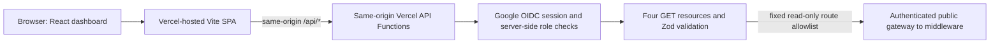

# ZohoAmarco Monitoring Dashboard

ZohoAmarco Monitoring Dashboard is a read-only web application for monitoring invoice and credit-note fiscalization operations, receipt evidence, Zoho writeback state, reconciliation coverage, device diagnostics, and service health. It uses protected same-origin server functions to reach the authenticated middleware gateway.

The dashboard does not submit fiscalization requests, create or update Zoho documents, retry transactions, operate fiscal hardware, or modify reconciliation or manual-review records. The existing Zoho button gateway is a separate workflow and is not used by this application.

## Current data availability

Dashboard reads require the public gateway URL and a dedicated server-held service credential. Missing settings return `503 UPSTREAM_UNCONFIGURED`. Gateway/middleware changes and desktop verification are required before a separately authorized production deployment. The application does not invent live records or silently fall back to demo fixtures.

Local development defaults to explicitly labeled `DEMO` fixtures. Demo identities and data are development-only and do not represent live accounting or fiscalization information.

## Features and availability

- **Overview:** request counts, status summaries, writeback rate, recent activity and charts when the selected source supplies those aggregates. Unsupported metrics are shown as unavailable.
- **Fiscalization:** invoice and credit-note lists, bounded search, date/status filters, page navigation, sorting within the loaded page, CSV export, and detail views for status, attempts, receipt/CU evidence, fiscal QR and writeback information when supplied.
- **Writeback:** read-only per-request writeback state, filters and detail links. The source does not provide a complete writeback collection; the page identifies that limitation.
- **Monitoring:** manual-review records with partial/lower-bound coverage where applicable, reconciliation availability and conflicts where supplied, and explicit missing-coverage states.
- **G03 device:** device identity, communication and readiness fields are shown only if supplied. Unknown serial, physical health, and communication history remain unavailable.
- **Services:** middleware and dependency health where supplied. A service status is not presented as proof of gateway health.
- **Settings:** display-only account, session, environment and connection status.
- **Shared interface:** responsive navigation, refresh, global date range, command palette, notifications and session logout.

External data dependent pages remain useful in unconfigured mode by explaining that data is unavailable. See [the API integration guide](docs/API-INTEGRATION.md) and [source contract audit](docs/API-CONTRACT-AUDIT.md) for capability limits.

## Architecture



The browser calls only `/api/dashboard/*` on its own origin. It never calls the upstream gateway directly. Local demo mode uses validated fixtures and does not call the dashboard API.

## Technology

The actual application stack is React 19, TypeScript, Vite 8, React Router, TanStack Query, Zod, Recharts, Framer Motion, React Hook Form, Sonner, Tailwind CSS 4 via the Vite plugin, and Lucide icons. The serverless API uses Node.js built-ins and the Vercel request/response function interface. Tests use Vitest, jsdom, and Testing Library; linting uses ESLint and formatting uses Prettier.

## Repository layout

```text
api/
  _lib/                 OIDC/session security and dashboard gateway
  auth/[...auth].ts     Google login, callback, session, logout
  dashboard/[...path].ts Protected dashboard GET API
src/
  app/                  Application shell, route views, and UI tests
  components/layout/    Command palette, notifications, shared UX
  features/api/         DTO schemas, queries, API pages, fixtures, tests
  lib/                  Runtime config, API client, auth provider
  mocks/                Development-only demo data and provider
  types/                Domain and dashboard types
docs/                   API, auth, development, architecture, deployment
.github/workflows/      CI verification workflow
```

Important root files: `package.json` defines commands and runtime versions; `pnpm-lock.yaml` locks dependencies; `vite.config.ts` configures the SPA and `@` source alias; `vercel.json` defines function limits, SPA fallback and security headers; `.env.example` contains safe local placeholders.

## Requirements

- Node.js `>=22.12.0 <23` (Vercel Node.js 22).
- pnpm `12.16.1` as declared by `packageManager`.
- A Google Cloud OAuth Web client and Vercel project for hosted authentication.
- Data integration requires authenticated gateway GET support. Desktop verification targets port 3004.

Install prerequisites before using the commands below. On Windows, use PowerShell from the repository root.

## Local development

```powershell
pnpm install --frozen-lockfile
Copy-Item .env.example .env.local
pnpm dev
```

Open the local URL printed by Vite. The example selects `VITE_DATA_MODE=mock` and `VITE_AUTH_MODE=development-mock`: the interface is labeled as demo, uses local fixtures and makes no dashboard API or upstream requests. Vite development intentionally disables the production API transport. Do not use demo values for operations or accounting.

Available commands:

```powershell
pnpm run typecheck
pnpm run lint
pnpm run format:check
pnpm test
pnpm run build
pnpm run preview
```

`pnpm run format` rewrites formatting; `pnpm run format:check` only checks. The build script already runs TypeScript project checks and Vite using the Node native config loader.

## Environment variables

Copy `.env.example` to `.env.local` for local use. All `VITE_` variables are compiled into browser-visible client code; never put credentials or private values in them. The remaining variables are server-only and belong in Vercel Function environment settings, not in browser code.

| Variable                      | Required                | Scope / sensitive                   | Purpose and example                                                                              | Environments                           |
| ----------------------------- | ----------------------- | ----------------------------------- | ------------------------------------------------------------------------------------------------ | -------------------------------------- |
| `VITE_DATA_MODE`              | Yes for production      | Public, not secret                  | `mock` only for local demo; production must use `api`.                                           | Local, Preview, Production             |
| `VITE_AUTH_MODE`              | No                      | Public, not secret                  | `development-mock` enables a local demo identity only in Vite development. Do not set on Vercel. | Local only                             |
| `VITE_REFRESH_INTERVAL_MS`    | No                      | Public, not secret                  | Refresh interval in milliseconds, minimum 10000; default `30000`.                                | Local, Preview, Production             |
| `DASHBOARD_UPSTREAM_BASE_URL` | Yes for dashboard reads | Server-only, usually not secret     | `https://g11server.tailaff2e5.ts.net`; exact HTTPS gateway origin.                               | Authorized deployment only             |
| `DASHBOARD_UPSTREAM_TOKEN`    | Yes for dashboard reads | Server-only secret                  | Dedicated dashboard service Bearer credential shared with the gateway/middleware.                | Authorized deployment only             |
| `DASHBOARD_AUTH_URL`          | Yes for hosted login    | Server-only, not secret             | Exact HTTPS origin, e.g. `https://dashboard.example.com`; no path.                               | Each enabled Preview/Production origin |
| `DASHBOARD_SESSION_SECRET`    | Yes for hosted login    | Server-only secret                  | Random signing secret of at least 32 bytes. Generate with the command below.                     | Unique per environment                 |
| `GOOGLE_CLIENT_ID`            | Yes for hosted login    | Server-only identifier              | Google OAuth Web client ID.                                                                      | Each enabled environment               |
| `GOOGLE_CLIENT_SECRET`        | Yes for hosted login    | Server-only secret                  | Google OAuth Web client secret. Never commit it.                                                 | Each enabled environment               |
| `DASHBOARD_ALLOWED_USERS`     | Yes for hosted login    | Server-only; contains personal data | JSON email-to-role map, e.g. `{"admin@example.com":"admin","viewer@example.com":"viewer"}`.      | Each enabled environment               |

Generate a session secret locally and copy its output directly to the Vercel secret field:

```powershell
node -e "process.stdout.write(require('node:crypto').randomBytes(48).toString('base64url'))"
```

The example file uses placeholders and selects local demo mode; it contains no usable Google or upstream credentials. Never commit `.env`, `.env.local`, `.env.production`, or any other `.env.*` file. `.env.example` is intentionally tracked.

## Authentication and roles

Hosted authentication uses Google OpenID Connect and is separate from Zoho OAuth. Create a Google OAuth client with application type **Web application**. For each deployment origin, add the exact authorized redirect URI:

```text
https://<dashboard-origin>/api/auth/callback
```

Set the corresponding exact origin (without a path) in `DASHBOARD_AUTH_URL`. Google Cloud also needs the appropriate consent-screen configuration and authorized domain. Add only approved users to `DASHBOARD_ALLOWED_USERS`; supported roles are `admin`, `operator`, and `viewer`. All roles are read-only and currently share dashboard read access.

The flow validates OAuth state, nonce, PKCE, Google token signature and claims, verified email, and the allowlist. The server issues an eight-hour signed `HttpOnly`, `Secure`, `SameSite=Lax` host-only cookie. Logout is same-origin POST. Sessions are stateless; removing a user blocks their next API request, while individual session revocation is unavailable until expiry unless the signing secret is rotated. Login rate limiting is not implemented in the app; configure hosting-edge protection before broad public access.

Troubleshooting: a callback mismatch means the Google redirect URI and `DASHBOARD_AUTH_URL` do not exactly match the deployed origin. `401` means no valid session; `403` means the Google account is not allowlisted or lacks access. Missing or invalid auth settings fail closed with `503 authentication_unavailable`. The function logs only invalid setting names, never values.

## Dashboard API

All dashboard data routes are same-origin, authenticated, read-only `GET` endpoints. They return `Cache-Control: no-store`. The auth endpoints are described separately below.

| Method and route                  | Purpose                                                         |
| --------------------------------- | --------------------------------------------------------------- |
| `GET /api/dashboard/overview`     | Required `createdFrom` and `createdTo`; date-bounded aggregates |
| `GET /api/dashboard/invoices`     | Pagination, search, dates and supported invoice filters         |
| `GET /api/dashboard/credit-notes` | Pagination, search, dates and supported credit-note filters     |
| `GET /api/dashboard/services`     | Observational service/dependency status                         |
| `GET /api/auth/login`             | Existing Google login                                           |
| `GET /api/auth/callback`          | Existing OAuth callback/session creation                        |
| `GET /api/auth/session`           | Existing allowlisted session                                    |
| `POST /api/auth/logout`           | Existing same-origin logout                                     |

Only these four data resources are forwarded. Standalone manual-review is unavailable;
other unsupported resources are rejected locally without fetch. Demo fixtures remain
available in Vite mock mode.

Query limits and response schemas are enforced with Zod. Data routes return `400` for invalid parameters, `401` for unauthenticated requests, `403` for rejected authorization, `404` for unknown resources, `405` for unsupported methods, `502` for invalid/unavailable upstream responses and `503` when auth/upstream is unconfigured. Error bodies are normalized and do not expose upstream response content. All data routes reject non-GET methods.

## Middleware gateway integration

The server forwards only overview, invoices, credit-notes and services GET resources to the configured HTTPS gateway. It requires a dedicated service credential, rejects redirects, bounds responses and validates JSON. The production hostname is allowed; no testing-only mode is required. Existing browser session handling is unchanged.

Standalone manual-review requests are removed from live transport; unsupported resources are rejected before fetch. Schemas remain unchanged until actual responses demonstrate a mismatch. Use the opt-in desktop tests on port 3004 before a separately authorized deployment. See [current integration and test instructions](docs/API-INTEGRATION.md). The older contract audit is historical, not current production evidence.

## GitHub setup

Create an empty GitHub repository. Check that no real environment files or credentials are staged. Then use the repository root and your actual GitHub URL:

```powershell
git add .
git status --short
git commit -m "Prepare ZohoAmarco monitoring dashboard"
git branch -M main
git remote add origin https://github.com/<your-account>/<repository>.git
git push -u origin main
```

If a remote named `origin` already exists, inspect it before changing it. The repository includes a GitHub Actions workflow that installs with the frozen pnpm lockfile and runs typecheck, lint, format check, tests and build on pushes and pull requests.

## Vercel deployment

1. Import the GitHub repository in Vercel and use the repository root.
2. Framework preset: **Vite**; Node.js: **22**.
3. Install command: `pnpm install --frozen-lockfile`.
4. Build command: `pnpm run build`.
5. Output directory: `dist`.
6. Leave function discovery at the default; Vercel discovers handlers in root `api/`. `vercel.json` sets function durations and security headers; the SPA rewrite is a fallback after function routing.
7. Configure environment variables separately for Preview and Production only after deployment authorization. Use `VITE_DATA_MODE=api`, existing auth settings, the gateway origin and dedicated dashboard credential.
8. Add each exact deployment origin to `DASHBOARD_AUTH_URL` and its Google OAuth callback as `https://<origin>/api/auth/callback`. Preview URLs require their own matching OAuth configuration if preview login is enabled.
9. Deploy from Vercel when ready. Set up any custom domain in Vercel first, then update the auth origin and Google callback to that final HTTPS domain.
10. After an authorized deployment, verify `/api/auth/session`, unauthorized reads, and the four supported resources. No deployment is performed by local implementation or tests.

More detail: [GitHub-to-Vercel deployment](docs/VERCEL-DEPLOYMENT.md) and [gateway integration](docs/API-INTEGRATION.md). The Zoho submission POST is unchanged.

## Security

Authentication and authorization are enforced in serverless handlers, not trusted from browser-supplied roles. Session signing keys, Google client secrets and required dashboard service credentials are server-only. The gateway is fixed-route and GET-only, does not use a persistent filesystem, and never calls the Zoho fiscalization submission POST. Security headers include CSP, HSTS, frame denial, MIME sniffing protection, referrer policy and a restrictive permissions policy.

The application does not implement login rate limiting; use hosting-edge rate controls before broad exposure. Keep Vercel Preview access restricted and do not configure Preview with production data credentials. Rotate any credential accidentally committed before publishing; deleting a committed secret does not remove it from Git history.

## Tests and verification

The test suite includes frontend route and interaction tests, mock no-network behavior, API client/query/schema tests, gateway validation and error tests, and authentication/session tests using mocked provider/upstream responses. Normal tests do not contact middleware, database, Zoho, gateway or device. Explicit desktop integration tests contact only port 3004; see the integration guide. Run the exact verification set:

```powershell
pnpm install --frozen-lockfile
pnpm run typecheck
pnpm run lint
pnpm run format:check
pnpm test
pnpm run build
```

See the CI workflow at `.github/workflows/`. These commands must pass in the target environment before release; deployment itself is not verified by a local build.

## Known limitations

- Matching gateway/middleware source, authenticated GET support and desktop responses are required to finish end-to-end verification.
- Device serial number, physical health, last communication and history are not available from the audited source.
- Service data does not establish gateway health or last successful gateway communication.
- The source lacks complete writeback and reconciliation collections, a complete manual-review total, historical uptime, financial totals and processing-time trends. Any counts without complete coverage are marked partial or lower-bound where supported.
- Sorting is limited to the records loaded on the current page; it is not a global server sort.
- OAuth sessions are stateless and cannot be individually revoked before expiry without rotating the signing secret.
- Browser automation and a deployed Preview environment were not part of the repository test suite.

## Troubleshooting

- **`503 authentication_unavailable`:** the auth function ran but rejected its configuration before checking the session. In Vercel Runtime Logs, find `[dashboard-auth] Invalid server configuration`; it lists invalid variable names only. Check `DASHBOARD_AUTH_URL` (exact HTTPS origin, no path or trailing slash), `DASHBOARD_SESSION_SECRET` (at least 32 bytes), `GOOGLE_CLIENT_ID`, `GOOGLE_CLIENT_SECRET`, and `DASHBOARD_ALLOWED_USERS` (nonempty JSON email-to-role map). Configure each in every environment where login is enabled. Vercel Preview and Production variables are separate: a value set only for Production is unavailable to Preview deployments. Redeploy the affected environment after changing settings. Do not put server-only values in `VITE_` variables.
- **Google callback mismatch:** use the exact `https://<origin>/api/auth/callback` URL in Google and the matching origin in `DASHBOARD_AUTH_URL`.
- **`401`:** sign in again; the session may be absent, expired or invalid.
- **`403`:** check the normalized email and role in `DASHBOARD_ALLOWED_USERS`.
- **`503 UPSTREAM_UNCONFIGURED`:** configure the gateway origin and dedicated dashboard read credential in an authorized environment. Never use Zoho or operator credentials.
- **`502` / invalid upstream response:** verify test API reachability, allowed routes, timeout and exact Zod DTO compatibility. Upstream error bodies are intentionally hidden.
- **API URL returns HTML:** confirm Vercel discovered root `api/` functions and that the deployment used this repository root; `/api/*` must not return `index.html`.
- **Build/install failure:** use Node 22.12+ and pnpm 12.16.1, then run the frozen-lockfile install from the repository root.
- **Cookie/session trouble:** use HTTPS, an exact auth origin and matching Google callback. The session cookie is host-only, secure and same-site lax.
