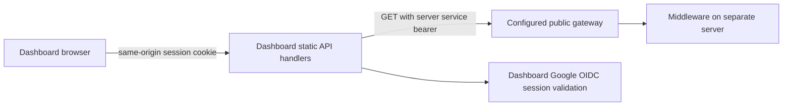

# Dashboard architecture

This is a dashboard-only repository: React 19 / TypeScript / Vite 8, React Router,
TanStack Query, Zod, Recharts, Framer Motion, Lucide and the existing dark design
system. `src/main.tsx` starts the application; `src/app/App.tsx` owns protected
routes and navigation. Vercel serves the SPA and static Node API handlers.

The configured origin is `DASHBOARD_UPSTREAM_BASE_URL`; its GET credential is
`DASHBOARD_UPSTREAM_TOKEN`. Neither is exposed through Vite environment variables.
The browser, dashboard and tests do not connect to middleware persistence,
Zoho Books, G03, ZFPLabServer or a middleware filesystem. The authoritative local
reference is [dashboard-api-contract.md](dashboard-api-contract.md).

All dashboard routes use static files. Document detail identifiers are strict local
query parameters encoded into one fixed document path segment. Other unavailable
request-detail handlers do not forward identifiers upstream. No dashboard
catch-all is present; the SPA fallback excludes `/api`. Compatibility routes
for unsupported health/metrics/writeback detail reads return explicit errors.
System health uses the documented `/api/dashboard/services` endpoint.

GET routes require a valid local session and a current server-allowlisted
admin/operator/viewer role. Overview, invoices, credit-notes and services retain
their existing paths; the requests alias uses invoices. The four document GET
mappings reuse this same handler. Their confirmed response envelopes use isolated
provisional nested projections with unknown provider fields stripped. The existing
document pages render registers/details; actual field compatibility and authenticated
live access remain unverified. See [document integration status](DOCUMENT-API-INTEGRATION.md).
All other unsupported local
handlers validate authentication/query inputs and return unavailable errors
without fetching. Fiscalization/writeback action handlers have been removed.
The service bearer never authorizes a POST.

Existing strict DTOs are retained for the four forwarded resources. Other schemas
remain available to the demo UI but do not establish public gateway exposure.
The separate server investigation supplied for final review verifies the four
gateway GET paths and service bearer flow to the same middleware paths at
`127.0.0.1:3001`. Actual production payload DTO compatibility and external
connectivity from Vercel remain unverified.

Local Vite demo mode requires explicit fixture and mock-auth settings. Production
rejects mock mode and never substitutes fixtures after a transport or contract
failure. Logout clears protected cookies and client caches; shared persistent
revocation of previously copied stateless cookies is not implemented.

See [secure BFF report](SECURE-BFF-REPORT.md), [gateway review](gateway-review.md)
and [security review](SECURITY-REVIEW.md) for scope, mapping and limitations.
