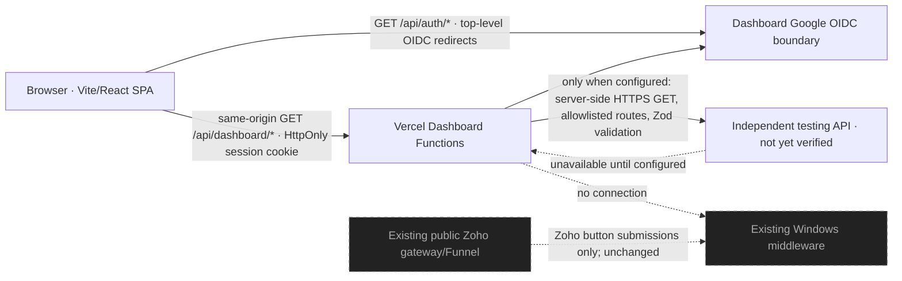

# Dashboard architecture

The frontend is a standalone Vite/React SPA. Vercel serves the static build and Node serverless functions. The browser calls only same-origin dashboard APIs. Functions enforce the dashboard session and role, then optionally call the configured independent testing API with fixed GET routes. Upstream URL/token values remain server-side.

Local development uses explicitly selected local fixtures. Production rejects mock mode, never falls back to fixtures, and returns safe unavailable errors when auth or upstream settings are missing. The current mission did not verify an independent testing API, so the server-side upstream is left inactive.

The dashboard is monitoring-only. It does not call the existing Zoho submission gateway, middleware, PostgreSQL, Zoho APIs or G03 hardware. The local middleware source has a dedicated dashboard route set, but its existence does not prove an independent test deployment. See [contract audit](API-CONTRACT-AUDIT.md).
