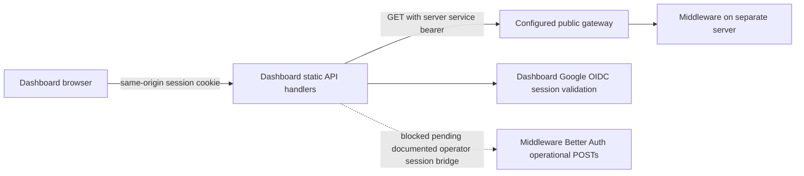

# Dashboard architecture

This is a dashboard-only repository: React 19 / TypeScript / Vite 8, React Router,
TanStack Query, Zod, Recharts, Framer Motion, Lucide and the existing dark design
system. `src/main.tsx` starts the application; `src/app/App.tsx` owns protected
routes and navigation. Vercel serves the SPA and static Node API handlers.

The configured origin is `DASHBOARD_UPSTREAM_BASE_URL`; its GET credential is
`DASHBOARD_UPSTREAM_TOKEN`. Neither is exposed through Vite environment variables.
The browser, dashboard and tests do not connect to middleware persistence,
Zoho Books, G03, ZFPLabServer or a middleware filesystem. The authoritative local
reference is [dashboard-api-contract.md](dashboard-api-contract.md).

All dashboard routes use static files. Detail identifiers are strict query
parameters on the dashboard and encoded path segments upstream. No dashboard
catch-all is present; the SPA fallback excludes `/api`. Compatibility routes
for unsupported health/metrics/writeback detail reads return explicit errors.
System health uses the documented `/api/dashboard/services` endpoint.

GET routes require a valid local session; upstream GETs use only the server
service bearer. Operational POST handlers validate local operator/admin sessions,
origin, query and body, then return `OPERATOR_SESSION_UNAVAILABLE` because the
contract does not document how to establish/forward the distinct middleware
Better Auth operator session. The GET bearer never authorizes a POST.

Existing strict DTOs are retained for persisted invoice/credit-note requests,
overview, services, capabilities and device data. The explicitly defined
writeback-operation page DTO is implemented. New document/manual-review/
reconciliation/events/pending-operation DTOs omitted by the local contract remain
explicit errors rather than permissive JSON, invented records or empty success.
Existing DTO compatibility with deployed middleware remains unverified.

Local Vite demo mode requires explicit fixture and mock-auth settings. Production
rejects mock mode and never substitutes fixtures after a transport or contract
failure. Logout clears protected cookies and client caches; shared persistent
revocation of previously copied stateless cookies is not implemented.

See [implementation report](IMPLEMENTATION-REPORT.md), [gateway review](gateway-review.md)
and [security review](SECURITY-REVIEW.md) for scope, mapping and limitations.
